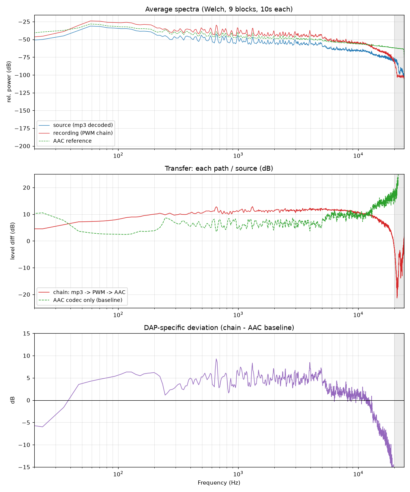

# PWM 出力の測定記録(MEASUREMENT)

PWM アナログ出力(`audio_pwm_mode=2` + 自作フィルタ基板)の性能を、ライン入力による測定で検証した記録です。測定日: 2026-11-22/23。

## 測定環境

| 項目 | 内容 |
| :--- | :--- |
| 被測定機 | 本 DAP(PWM 出力、3.5mm)、音量 54% / 100% の 2 条件 |
| キャプチャ | MSI X99A SLI PLUS のオンボード音声チップ(Realtek)のライン入力 |
| RTA | REW(Room EQ Wizard)の RTA、1/12 オクターブ、29〜32 平均 |
| 録音 | Windows 標準のボイスレコーダー(m4a / AAC-LC 320kbps / 96kHz) |
| 解析 | Python(ffmpeg で 96kHz float デコード → scipy Welch 比較) |

## 使用した信号と用途の使い分け

| 信号 | 用途 |
| :--- | :--- |
| **ピンクノイズ**(REW で生成) | 周波数特性・SNR。全オクターブに平坦なエネルギーなので、録音/ソース比が全帯域で検定できる |
| **無音**(再生なし、Ping 応答のみ) | ノイズフロア。SNR 計算の分母 |
| **楽曲**(Last Fortune -Short Ver.-, mp3 320kbps/44.1kHz) | ループバック比較(AAC コーデックの挙動分離・実運用条件の確認) |
| **1kHz サイン波** | THD 測定用(将来測定。ピンクノイズでは高調波が埋もれて測定不可) |

測定したいものに合わせて信号を選ぶのがポイント: 特性はピンクノイズ、歪みはサイン波、実運用の確認は楽曲。

## 測定手順と結果

### 1. 無音フロア

再生なし(Ping 応答のみ)の状態で RTA を 32 平均。帯域内(22Hz-22kHz)ノイズ **26.2 dB**。

### 2. 音量別 SNR(ピンクノイズ)

ピンクノイズを音量 54% / 100% で再生し、帯域内(22Hz-22kHz UNW)レベルを測定。無音フロアとの差分から SNR を算出(FS 換算)。

| 測定 | ピーク | 帯域内レベル | FS 換算 SNR |
| :--- | :--- | :--- | :--- |
| 1 回目 | -40.6 dBFS | 66.2 dB | 80.6 dB |
| 2 回目(音量 54%) | -23.9 dBFS | 81.9 dB | 79.6 dB |
| 3 回目(音量 100%) | -14.3 dBFS | 93.4 dB | 81.5 dB |

**SNR ≈ 80-81.5 dB(実効 ENOB ≈ 13.2 bit)**。3 つの独立条件で ±1dB に収束。

### 3. 楽曲ループバック(AAC 基準差し引き)

楽曲を再生しライン録音したファイルと、元 mp3 をデコードした波形を 0.259 秒で時間整合・ゲイン整合したうえで比較。録音は AAC 経由のため、**元データを同一条件(AAC-LC 320kbps/96kHz)で再エンコードした基準**を用意し、コーデック起因の誤差を差し引いて DAP チェーン固有の差分だけを抽出した。

| 帯域 | DAP 固有の伝達差分 |
| :--- | :--- |
| 20-100Hz | -5.7 → +2.2 dB(100Hz コーナー: カップリング容量のハイパス) |
| 100Hz-6kHz | **+4〜6 dB**(EQ 設定 BASS+1/MID+2/TREBLE+2 の指紋) |
| 6-15kHz | +1.6 → -1.8 dB(緩やかな高域落ち) |
| 15-20kHz | **-10.8 dB**(再構成フィルタのロールオフ) |
| 20-24kHz | **-36 dB**(アンチイメージノッチ) |

予期しないアーティファクトは検出されず。特性の内訳は「意図的な EQ」「カップリング容量」「48kHz サンプリングの再生フィルタ」で完全に説明できる。

## 結論

| 項目 | 実測値 |
| :--- | :--- |
| SNR | **約 80-81.5 dB**(帯域内 UNW) |
| 実効 ENOB | **約 13.2 bit** |
| 帯域 | **約 100Hz - 20kHz**(-3dB) |
| 超音波残留(22kHz 超) | 信号比 **-69 dB 以下** |
| アンチイメージ | 20kHz 以上で -36 dB |

弱点は SNR ではなく**低域のハイパス特性**(カップリング容量由来)。低域の伸びが必要なら EQ の BASS 補償か、出力カップリングの容量増(実効 ~250µF 級)が対象。

## 注意事項

- 録音は AAC-LC 経由のため、20kHz 以上の伝達特性にはコーデックのローパスが混ざる(純粋な電気特性はピンクノイズ RTA のほうが正確)
- 無音フロア測定時はライン入力ゲインを再測定時と同一に保つこと
- クロックドリフトは実測 -19ppm(100 秒で 2ms)で、ブロック単位の再同期で補償した
